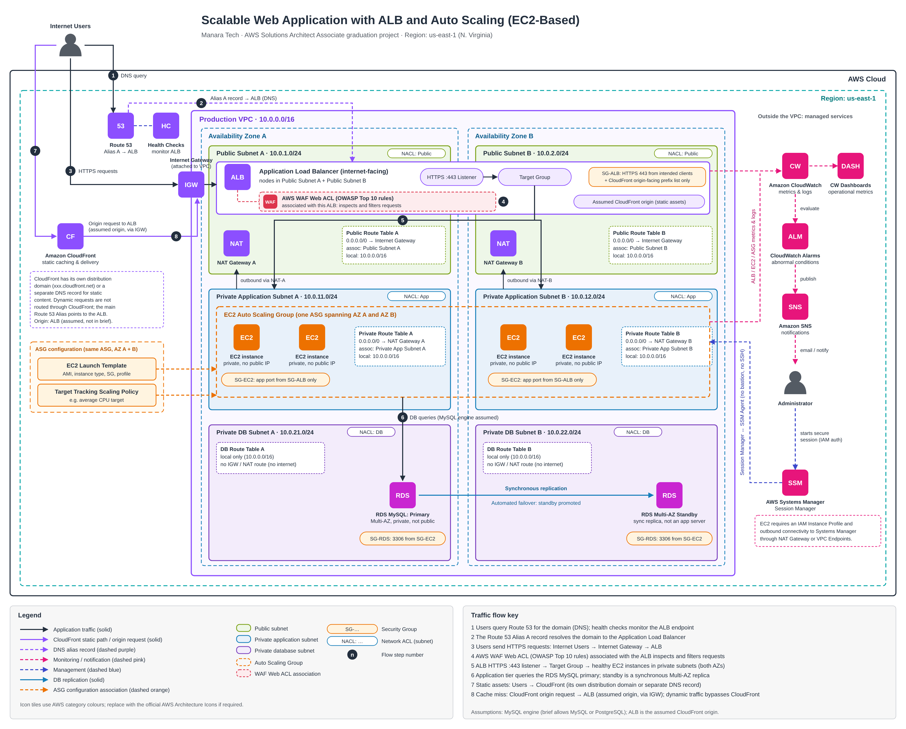

# Scalable Web Application with ALB and Auto Scaling (EC2-Based)

**Manara Tech · AWS Solutions Architect Associate · Region: us-east-1**

A highly available and scalable web application architecture built on AWS using Amazon EC2, Application Load Balancer, Auto Scaling, and Amazon RDS.

> **Project Type:** Architecture Design  
> This repository documents the proposed architecture and its design decisions. It does not represent a deployed or production-tested environment.

## Architecture Diagram

**Editable source:** [aws-architecture-diagram.svg](architecture/aws-architecture-diagram.svg) (opens in draw.io, Inkscape, and other compatible tools).

## 1. Architecture Summary

### Network Architecture

- **VPC:** A production-style VPC using CIDR `10.0.0.0/16`.
- **Availability Zones:** Two Availability Zones to improve availability and fault tolerance.
- **Subnets:** Six subnets distributed across the two AZs:
  - Public Subnets: `10.0.1.0/24` and `10.0.2.0/24`.
  - Private Application Subnets: `10.0.11.0/24` and `10.0.12.0/24`.
  - Private Database Subnets: `10.0.21.0/24` and `10.0.22.0/24`.
- **Internet Gateway:** Attached to the VPC to provide internet connectivity for resources in public subnets.
- **NAT Gateways:** One NAT Gateway in each public subnet. Each private application subnet routes its outbound internet traffic through the NAT Gateway in the same AZ.
- **Database Subnets:** Private database subnets have no direct route to the internet.

This design improves availability while keeping application and database resources isolated from direct public access.

### Traffic Flow and Entry Point

The main application traffic follows this path:

`Internet Users → Route 53 → Application Load Balancer → Target Group → Healthy EC2 Instances`

- **Amazon Route 53:** A DNS Alias A record points the main application domain to the Application Load Balancer.
- **Application Load Balancer (ALB):** Internet-facing and deployed across both public subnets.
- **HTTPS Listener:** Listens on port `443` and uses an SSL/TLS certificate from AWS Certificate Manager (ACM).
- **Target Group:** Registers EC2 instances managed by the Auto Scaling Group and performs health checks.
- **AWS WAF:** A Web ACL is associated with the ALB to inspect and filter incoming HTTP/HTTPS requests. AWS Managed Rules, such as the Core Rule Set, can help protect against common web exploits. These rules provide protection against common attack patterns but do not guarantee complete coverage of every OWASP Top 10 risk.

AWS WAF is associated with the ALB and is not a separate network hop in the traffic path.

### Compute Layer – EC2 and Auto Scaling

- **Amazon EC2:** Runs the application on private instances without public IP addresses.
- **Auto Scaling Group (ASG):** A single ASG spans both private application subnets across the two Availability Zones.
- **Launch Template:** Defines the EC2 instance configuration, including the AMI, instance type, storage, security groups, and IAM instance profile.
- **Target Tracking Scaling Policy:** Adjusts the number of EC2 instances based on a selected metric, such as average CPU utilization.
- **Application Load Balancer:** Distributes incoming requests across healthy registered instances.

This design supports horizontal scaling and helps maintain application availability when instances become unhealthy or demand increases.

### Database Layer – Amazon RDS

- **Amazon RDS for MySQL:** Hosts the application's relational database.
- **Multi-AZ Deployment:** Uses a primary DB instance in one AZ and a synchronous standby in another AZ.
- **Automatic Failover:** RDS can automatically fail over to the standby instance if the primary becomes unavailable.
- **Private Database Subnets:** The database is deployed in private subnets and is not publicly accessible.
- **Security:** The database security group allows inbound database traffic only from the application EC2 security group.

In a traditional RDS Multi-AZ DB instance deployment, the standby is intended for failover and is not used to serve read traffic.

### Static Content Delivery – Amazon CloudFront

- **Amazon CloudFront:** Used to cache and deliver static assets, such as images, CSS, and JavaScript files.
- **Origin:** The Application Load Balancer is configured as the CloudFront origin.
- **Cache Behavior:** Static asset paths are configured with appropriate cache policies and forwarded to the ALB origin.
- **DNS:** A separate DNS record or the CloudFront distribution domain is used to access static content. The main application DNS record continues to point directly to the ALB.
- **Dynamic Requests:** Dynamic application traffic goes directly to the ALB and does not pass through CloudFront in this design.
- **Origin Connection:** CloudFront communicates with the ALB over HTTPS.

The CloudFront distribution should be configured to cache only the intended static paths. Dynamic application requests are not routed through the distribution.

### Security Architecture

Security is implemented through multiple layers:

- **ALB Security Group:** Allows HTTPS traffic from intended application clients and permits CloudFront origin-facing traffic where required.
- **CloudFront Origin Access:** The CloudFront origin-facing managed prefix list can be used as a source restriction for CloudFront-to-ALB traffic. However, this prefix list alone does not identify a specific CloudFront distribution.
- **Origin Protection:** A custom origin header can be configured between CloudFront and the ALB, with an appropriate AWS WAF rule to validate requests for protected static paths.
- **EC2 Security Group:** Allows application traffic only from the ALB security group on the application port.
- **RDS Security Group:** Allows database traffic only from the EC2 application security group on the database port.
- **Network ACLs:** Applied at the subnet level for additional network traffic filtering. Because NACLs are stateless, inbound and outbound rules must account for return traffic.
- **Private Instances:** EC2 application instances and RDS database instances do not have direct public access.

### Monitoring and Operations

- **Amazon CloudWatch Metrics:** Collects available metrics for ALB, EC2, and Auto Scaling.
- **CloudWatch Agent:** Can be installed on EC2 instances to collect application and operating system logs and publish them to CloudWatch Logs.
- **ALB Access Logs:** Can be enabled and delivered to an Amazon S3 bucket.
- **CloudWatch Dashboards:** Provide a centralized view of system metrics.
- **CloudWatch Alarms:** Monitor selected metrics and trigger notifications when configured thresholds are reached.
- **Amazon SNS:** Delivers alarm notifications to the administrator.
- **AWS Systems Manager Session Manager:** Provides secure shell access to private EC2 instances without requiring a bastion host or inbound SSH access.
- **SSM Connectivity:** Requires an appropriate IAM instance profile and outbound connectivity through NAT Gateways or the required VPC endpoints.
- **Route 53 Health Checks:** Can monitor the application endpoint. Health checks can be used with appropriate DNS routing policies when DNS-level failover is required.

## 2. Key Design Decisions and Assumptions

1. **Database Engine:** MySQL was selected for Amazon RDS. The project requirements allow either MySQL or PostgreSQL.
2. **CloudFront Origin:** The ALB is used as the CloudFront origin for static assets because the project brief does not specify a separate origin.
3. **Traffic Routing:** The main application domain points directly to the ALB, while static content is accessed through a separate CloudFront domain or DNS record.
4. **Client Access:** ALB client sources are described as "intended clients" because the project requirements do not specify fixed source IP ranges.
5. **CloudFront Security:** The CloudFront origin-facing managed prefix list restricts traffic to CloudFront origin-facing IP ranges, but additional origin validation may be required to protect against requests from other CloudFront distributions.
6. **Systems Manager:** Private EC2 instances require an IAM instance profile and connectivity to Systems Manager endpoints through NAT Gateways or VPC endpoints.
7. **Monitoring:** CloudWatch Agent is required when application and operating system logs need to be collected from EC2 instances. ALB access logs are delivered to S3.
8. **Architecture Scope:** The diagram represents a proposed AWS architecture. Actual service deployment, configuration, and testing are outside the scope of this design document.

## 3. Architecture Validation Checklist

The following checklist maps the proposed architecture to the project requirements.

| # | Requirement | Status |
|---|---|---|
| 1 | Exactly two Availability Zones | Covered |
| 2 | Six subnets in the correct VPC and AZs, with CIDR blocks | Covered |
| 3 | NAT Gateway A and B in their respective public subnets | Covered |
| 4 | Internet Gateway attached to the VPC | Covered |
| 5 | Internet-facing ALB spanning both public subnets | Covered |
| 6 | EC2 instances in private application subnets with no public IPs | Covered |
| 7 | One Auto Scaling Group spanning both AZs | Covered |
| 8 | Launch Template and Target Tracking policy associated with the ASG | Covered |
| 9 | RDS Multi-AZ in private database subnets, not publicly accessible | Covered |
| 10 | RDS primary and Multi-AZ standby clearly identified | Covered |
| 11 | AWS WAF Web ACL associated with the ALB | Covered |
| 12 | CloudFront for static content caching with the ALB as origin | Covered |
| 13 | Route 53 Alias record pointing to the ALB | Covered |
| 14 | Security Groups, NACLs, and route tables represented | Covered |
| 15 | CloudWatch, SNS, and Systems Manager represented | Covered |
| 16 | Traffic, monitoring, and management paths distinguished in the diagram | Covered |

## 4. Architecture Benefits

- **High Availability:** Uses two Availability Zones for the application and database layers.
- **Scalability:** Auto Scaling adjusts the EC2 capacity based on application demand.
- **Fault Tolerance:** ALB health checks and RDS Multi-AZ help maintain service availability.
- **Security:** Uses private subnets, layered Security Groups, NACLs, AWS WAF, and Systems Manager.
- **Performance:** CloudFront caches static assets to reduce repeated requests to the origin.
- **Operational Visibility:** CloudWatch metrics, logs, dashboards, alarms, and SNS notifications support monitoring and troubleshooting.
- **Cost Awareness:** The architecture separates services and resources by purpose, allowing capacity and service costs to be reviewed and optimized.

---

**Project:** Scalable Web Application with ALB and Auto Scaling (EC2-Based)  
**Program:** Manara Tech – AWS Solutions Architect Associate  
**AWS Region:** us-east-1
